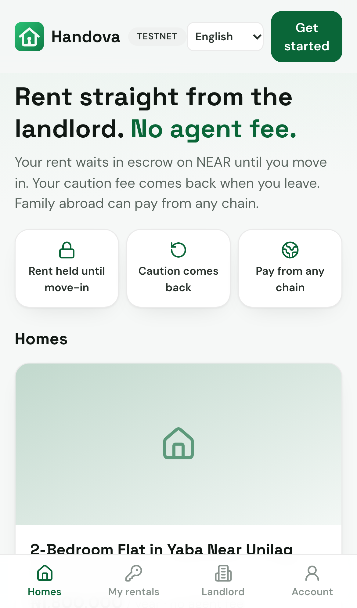
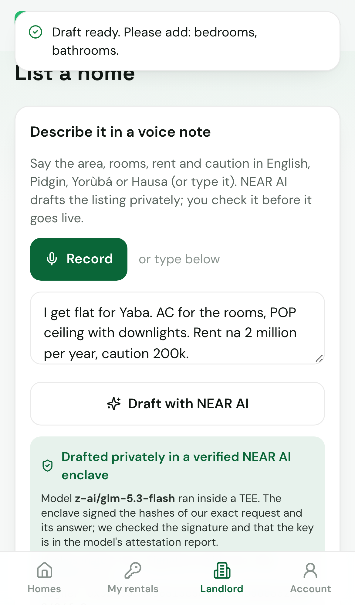
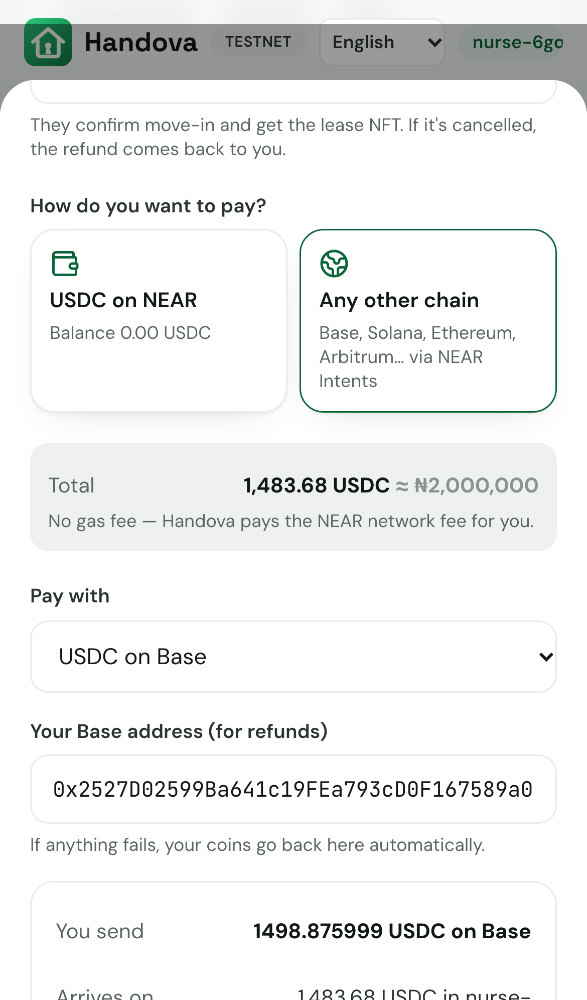
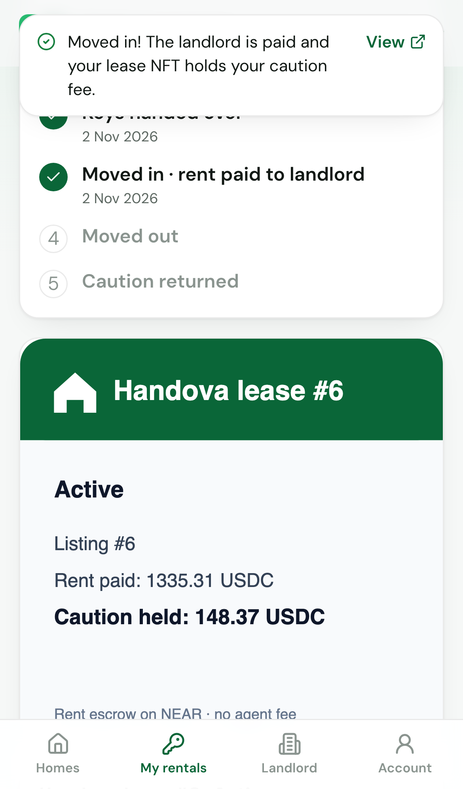
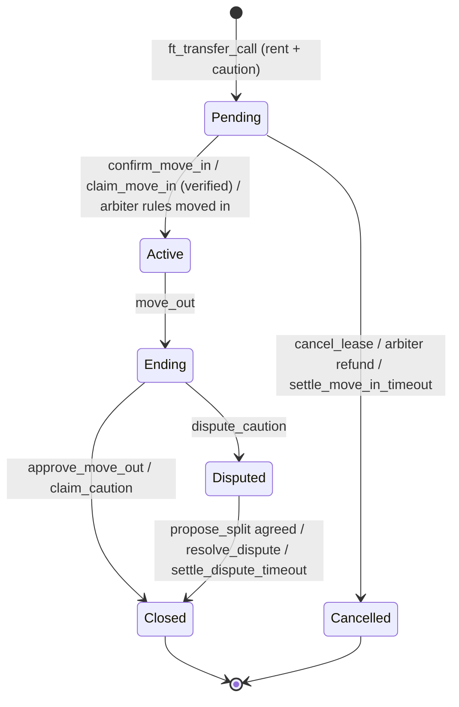
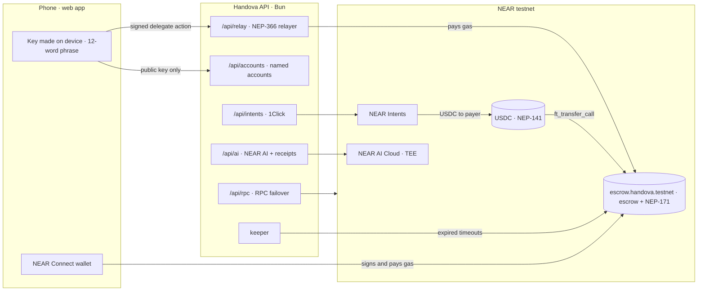
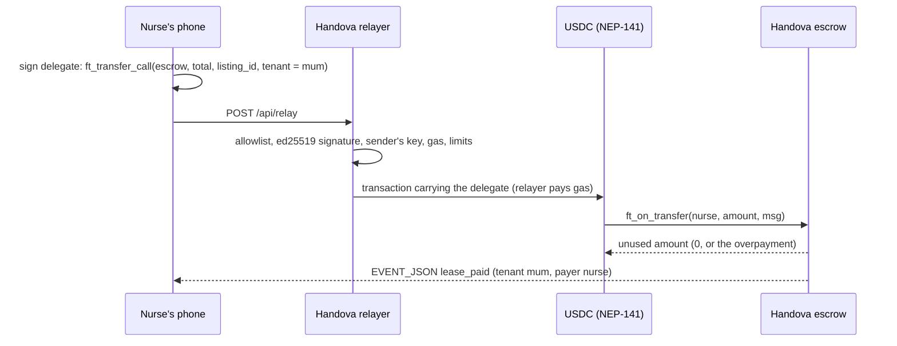

# Handova — rent in Lagos straight from the landlord, with the rent in escrow on NEAR

Handova lets a tenant rent a home directly from the landlord, with no agent. The tenant (or family abroad) pays rent and the caution fee in USDC into a NEAR smart contract. The landlord is paid when the tenant confirms they moved in (or, only for an ID-verified landlord, if the tenant ignores a marked handover for 3 days). The tenant then holds a **lease NFT that holds the caution fee**, and that fee comes back at move-out unless the landlord proves damage. People pay no gas, and they can pay from any chain through NEAR Intents. A tenant leaving early can **sell the rest of their lease** (with the landlord's consent), finished leases form an on-chain **rental passport**, disputes are decided by a **Sputnik DAO council**, and the app speaks **English, Naijá, Yorùbá, Hausa and Igbo**.

> **Status, plainly:** everything runs on **NEAR testnet** (contract [`escrow.handova.testnet`](https://testnet.nearblocks.io/address/escrow.handova.testnet)). NEAR Intents has no testnet, so the app shows a live 1Click quote and then **simulates** the deposit arriving with test USDC; the escrow payment after that is a real testnet transaction. No real landlords or tenants have used it yet.

**Built at NEAR HACKATHON (1–14 Nov 2026).** Tracks: `realworld`, `nfts`. Built on an earlier Arc version of Handova; only the NEAR work is the entry — see [Built before / during the hackathon](#built-before--during-the-hackathon).

- 🎬 **Demo video (3 min, real testnet):** [`docs/media/handova-demo.mp4`](docs/media/handova-demo.mp4)
- 🧪 **Reproduce it yourself:** [`REPRODUCE.md`](REPRODUCE.md) — three commands, your own testnet accounts, no keys from us
- 📜 **Contract:** [`contract/src/`](contract/src) · **Server:** [`server/near/`](server/near) · **Web app:** [`web/src/`](web/src) · **Browser tests:** [`e2e/`](e2e)

|  |  |  |  |
|---|---|---|---|
| Homes, priced in Naira | Voice note → listing (NEAR AI, verified TEE) | Pay from Base, Solana… (NEAR Intents) | Lease NFT holding the caution fee |

---

## Contents
1. [The problem](#the-problem)
2. [The one moment](#the-one-moment)
3. [How NEAR is used](#how-near-is-used)
4. [The lease NFT](#the-lease-nft-that-holds-the-caution-fee)
5. [Escrow rules and lease states](#escrow-rules-and-lease-states)
6. [Architecture](#architecture)
7. [Contract reference](#contract-reference)
8. [API reference](#api-reference)
9. [Try it](#try-it)
10. [Testing](#testing)
11. [Security model and known limits](#security-model-and-known-limits)
12. [Independent AI review](#independent-ai-review-near-ai-cloud)
13. [Configuration and deployment](#configuration-and-deployment)
14. [Built vs planned](#built-vs-planned)
15. [Built before / during the hackathon](#built-before--during-the-hackathon)

---

## The problem

- **A year up front, to strangers.** Rent is usually paid for the whole year before moving in. Fake listings take the money and disappear.
- **Fees on top.** Agent and agreement fees are added to the rent.
- **The caution fee is a gamble.** Getting the security deposit back depends on the landlord's goodwill.
- **Family abroad often pays.** Transfers to Nigeria are slow and expensive, and the payer has no say over when the landlord gets the money.

(We quote no market percentages: we have no cited source yet.)

## The one moment

> A nurse in London pays her mum's Lagos rent from a wallet on another chain → it lands in the Handova escrow on NEAR → mum confirms she moved in → only then is the landlord paid → mum holds the lease NFT → at move-out the caution fee returns to her. No agent fee, no gas.

| | What happens | NEAR piece |
|---|---|---|
| 1 | Ade (landlord) describes his flat in Pidgin; NEAR AI drafts the listing; he checks it and publishes | NEAR AI Cloud (TEE) · gasless `create_listing` |
| 2 | The nurse pays rent + caution **for mum** from Base USDC (or USDC on NEAR) | NEAR Intents 1Click → `ft_transfer_call` |
| 3 | The money is locked in the escrow, status `Pending` | `ft_on_transfer` |
| 4 | Ade marks the handover; mum confirms move-in | `mark_handover`, `confirm_move_in` |
| 5 | Rent is credited to Ade; mum receives lease NFT #N holding the caution | NEP-171 mint, live metadata |
| 6 | Ade withdraws the full rent | pull-based `withdraw` |
| 7 | Mum moves out; Ade approves; the caution goes to the NFT holder | `move_out`, `approve_move_out` |

Every step is in the [demo video](docs/media/handova-demo.mp4) (three phones side by side, recorded from the real app on testnet with [`scripts/record-demo.mjs`](scripts/record-demo.mjs)) and in [`bun run demo:testnet`](scripts/demo-testnet.ts).

## How NEAR is used

| Feature | NEAR technology | Where |
|---|---|---|
| Escrow that pays the landlord only after move-in; caution returned at move-out | Rust contract, near-sdk 5.30 | [`contract/src/escrow.rs`](contract/src/escrow.rs) |
| Pay rent + caution in **one transaction** | NEP-141 `ft_transfer_call` → `ft_on_transfer`; excess refunded | [`escrow.rs` `ft_on_transfer`](contract/src/escrow.rs) |
| Lease NFT that **holds** the caution fee | NEP-171 + enumeration + metadata in the same contract as the escrow | [`contract/src/nft.rs`](contract/src/nft.rs) |
| NFT that shows the live lease | Dynamic metadata: title, description, `extra` and an on-chain SVG built from the lease at view time | [`nft.rs` `live()`](contract/src/nft.rs), [`svg.rs`](contract/src/svg.rs) |
| No gas for users | NEP-366 meta transactions: the phone signs a delegate action; the relayer verifies it and pays gas | [`server/near/relayer.ts`](server/near/relayer.ts), [`shared/gasless.ts`](shared/gasless.ts) |
| Accounts for people without a wallet | Named sub-accounts `name.handova.testnet` created with the **device's own key**; 12-word recovery phrase | [`server/near/accounts.ts`](server/near/accounts.ts), [`web/src/lib/session.tsx`](web/src/lib/session.tsx) |
| Existing NEAR wallets | NEAR Connect (`@hot-labs/near-connect`): HOT, Meteor, MyNearWallet, Intear… | [`session.tsx`](web/src/lib/session.tsx) |
| Pay from any chain | NEAR Intents 1Click: `EXACT_OUTPUT` quote → deposit on the origin chain → USDC delivered to the payer's NEAR account → gasless `ft_transfer_call` into escrow | [`server/near/intents.ts`](server/near/intents.ts), [`IntentsPay.tsx`](web/src/components/IntentsPay.tsx) |
| Voice note or text → listing draft | NEAR AI Cloud, models in TEEs (`openai/whisper-large-v3`, `z-ai/glm-5.3-flash`); each answer has a receipt the server checks | [`server/near/ai.ts`](server/near/ai.ts) |
| Ownership document pre-check (admin, never approves) | NEAR AI Cloud vision model in a TEE (`Qwen/Qwen3-VL-30B-A3B-Instruct`) | `POST /api/ai/document-check` |
| Hand a lease to the next tenant | In-contract takeover market (holder's price, landlord's consent, buyer pays with one `ft_transfer_call`) plus NEP-178 approvals for external marketplaces | [`contract/src/market.rs`](contract/src/market.rs), [`nft.rs`](contract/src/nft.rs) |
| Rental passport | `rental_record` view computed from the finished lease NFTs an account held | [`market.rs`](contract/src/market.rs), [`Passport.tsx`](web/src/components/Passport.tsx) |
| Disputes decided by a council, not one key | Sputnik DAO (`sputnikv2.testnet`) as the arbiter: members propose a ruling and vote; the DAO calls the escrow | [`scripts/create-arbiter-dao.ts`](scripts/create-arbiter-dao.ts), [`web/src/lib/dao.ts`](web/src/lib/dao.ts), [`DaoRulings.tsx`](web/src/components/DaoRulings.tsx) |
| Timeouts nobody acted on | Keeper calls the contract's "anyone may trigger" methods | [`server/near/keeper.ts`](server/near/keeper.ts) |
| Following lease events | NEP-297 `EVENT_JSON` logs for every step | [`contract/src/events.rs`](contract/src/events.rs) |

Languages: the main screens are in English, Naijá (Pidgin), Yorùbá, Hausa and Igbo, using the wording the team wrote for the Arc version (new lines still need a native-speaker review). Listing drafts are tested on English and Pidgin text; voice goes through Whisper, which lists English, Yorùbá and Hausa (not Igbo).

## The lease NFT that holds the caution fee

An NFT on NEAR can't hold tokens by itself. So **one contract is both the escrow and the NEP-171 token contract**: the caution stays in the contract's USDC balance, and the right to get it back is bound to `nft_token(lease_id).owner_id` at payout time — not to a stored tenant address.

| Lease status | NFT | Caution |
|---|---|---|
| `Active` | Transferable (`nft_transfer`, `nft_transfer_call`). A new tenant takes over the lease; the caution right moves with it | Held |
| `Ending` (move-out review) / `Disputed` | **Locked** | Held |
| `Closed` | Locked; stays with the tenant as a record of a finished lease | Paid out (amounts recorded on the lease) |

The metadata is never stored: `nft_token`, `nft_tokens` and `nft_tokens_for_owner` compute the title (`Handova lease #2 · Active`), description, `extra` JSON (`status`, `caution_held`, `ends_at_ms`…) and an SVG picture from the current lease state.

NEP-171 transfers need exactly 1 yoctoNEAR, which the relayer never pays, so the holder signs a transfer directly (new accounts get 0.05 NEAR for this).

### Selling the rest of a lease (takeover)

A tenant who leaves early can hand the home — and the caution right — to the next tenant:

1. The holder calls `offer_takeover(lease_id, price)`.
2. The landlord calls `consent_takeover` (a lease never changes hands without the landlord).
3. The new tenant pays the price with one `usdc.ft_transfer_call(escrow, price, '{"take_over": <lease id>}')` — gasless in the app. The seller is credited the price, the NFT moves to the buyer (approvals cleared, NEP-171 `nft_transfer` event), and the buyer becomes the tenant.

Offers show on the home page under **Take over a lease**. An offer ends if the NFT moves another way. External marketplaces can also list an active lease through standard **NEP-178** approvals (`nft_approve`, `nft_revoke`, `nft_is_approved`).

### Rental passport

`rental_record(account_id)` turns the lease NFTs an account held into a record nobody can edit: leases finished, how many times the caution came back in full, caution kept for damage, months rented, rent paid. Tenants see it under **Account → My rental passport** (`#/passport/<account>`); a landlord sees a summary of the tenant's record on every lease waiting for a handover or a takeover.

## Escrow rules and lease states

| Situation | What happens on-chain |
|---|---|
| Tenant (or anyone for them) pays | Rent + caution locked, status `Pending`. Overpayment refunded; a bad `msg` refunds everything |
| Tenant confirms move-in | Rent credited to the landlord; lease NFT minted to the tenant (`Active`) |
| Landlord marked the handover, tenant silent 3 days | **Only for ID-verified landlords:** anyone can trigger `claim_move_in`. An unverified landlord always needs the tenant's confirmation, so a fake listing can't collect rent by silence |
| Holder offers the lease, landlord consents, a buyer pays | Seller paid the price; NFT and caution right move to the buyer, who becomes the tenant |
| Either side disputes the handover | `dispute_move_in` (once); the arbiter rules moved-in or full refund |
| Handover disputed, arbiter silent 7 days | Anyone can trigger `settle_move_in_timeout`: the payer is refunded in full |
| No handover within 7 days of payment | Tenant or payer cancels; the **payer** is refunded in full. The landlord can decline any time before move-in |
| Tenant moves out (or landlord, after the term ends) | 7-day landlord review (`Ending`): approve → full caution to the NFT holder; or dispute part of it |
| Landlord silent for the review window | Anyone can trigger `claim_caution`: full caution to the NFT holder |
| Caution dispute | Both propose the same split → settles; or the arbiter decides (never more than the landlord claimed); nobody settles in 7 days → 50/50, capped at the landlord's claim |
| Payouts | Pull-based `withdraw`; if the token transfer fails, the balance is restored |



The owner can change the verifier and arbiter but **cannot move anyone's money**. There is no upgrade method. Waiting periods are fixed at deployment (3 days handover claim; 7 days cancel, review and dispute).

## Architecture



Paying rent gaslessly, in one transaction:



| Folder | What |
|---|---|
| `contract/` | Rust escrow + lease NFT (`src/`), unit tests (`src/tests.rs`), sandbox tests (`tests/sandbox.rs`), test-only USDC (`mock-ft/`) |
| `server/near/` | NEAR API: relayer, accounts, Intents, NEAR AI, keeper, RPC proxy, FX rate |
| `server/index.ts` | API entry point (`bun run server`); `server/media.ts` handles photo uploads |
| `shared/` | Used by both browser and server: gasless client, transaction-outcome parsing, units |
| `web/` | The NEAR web app |
| `e2e/` | Playwright end-to-end suite against testnet |
| `deploy/<network>.json` | Contract IDs per network — nothing is hardcoded |
| `scripts/` | `setup-testnet.sh`, `deploy-testnet.sh`, `demo-testnet.ts`, `record-demo.mjs` + `compose-demo.mjs` (video), `ai-review.ts` |

## Contract reference

`escrow.handova.testnet` — init: `new(owner, verifier, arbiter, token, token_decimals?, timeouts?)`. Amounts are USDC base units (1 USDC = `1000000`).

**Calls**

| Method | Who | Effect |
|---|---|---|
| `create_listing(rent, caution, term_months, property_ref)` | anyone (landlord) | New listing; rent ≥ 1 USDC; `property_ref` = listing details as JSON (≤1 KB); 3 listings until verified, 50 after |
| `update_listing(listing_id, rent?, caution?, term_months?, property_ref?, available?)` | landlord | Pause/resume; prices only while no lease is open |
| `ft_on_transfer` (via `usdc.ft_transfer_call`, `msg: {"listing_id":N,"tenant":"optional"}`) | USDC contract | Pay rent + caution; creates a `Pending` lease |
| `mark_handover(lease_id)` | landlord | Starts the 3-day silence window |
| `confirm_move_in(lease_id)` | tenant | Rent to landlord, NFT to tenant |
| `claim_move_in(lease_id)` | anyone | After the window, verified landlords only |
| `dispute_move_in(lease_id, reason)` | tenant or landlord, once | Sends the handover to the arbiter |
| `resolve_move_in(lease_id, moved_in)` | arbiter | Moved in, or full refund |
| `settle_move_in_timeout(lease_id)` | anyone | Arbiter silent 7 days → payer refunded |
| `cancel_lease(lease_id)` | landlord any time before move-in; tenant/payer after 7 days with no handover | Full refund to the payer |
| `move_out(lease_id)` | NFT holder; landlord after the term ends | Starts the 7-day review |
| `approve_move_out(lease_id)` | landlord | Full caution to the holder |
| `dispute_caution(lease_id, landlord_claim, reason)` | landlord, during review | Opens a caution dispute |
| `claim_caution(lease_id)` | anyone, after the review window | Full caution to the holder |
| `propose_split(lease_id, landlord_amount)` | landlord or holder | Equal proposals settle |
| `resolve_dispute(lease_id, landlord_amount)` | arbiter | ≤ the landlord's claim |
| `settle_dispute_timeout(lease_id)` | anyone, after the dispute window | 50/50, capped at the claim |
| `withdraw(amount?)` | anyone with a balance | Sends USDC; restored on failure |
| `nft_transfer`, `nft_transfer_call` | holder (or an approved marketplace), 1 yocto, `Active` only | Moves the lease and its caution right |
| `nft_approve`, `nft_revoke`, `nft_revoke_all` | holder, `Active` only for approve | NEP-178 approvals for marketplaces |
| `offer_takeover(lease_id, price)` / `cancel_takeover(lease_id)` | NFT holder, `Active` | Offer the rest of the lease for a USDC price |
| `consent_takeover(lease_id)` | landlord | Allow the offer to be bought |
| `ft_on_transfer` with `msg: {"take_over": <lease id>}` | USDC contract | Buy a consented takeover |
| `set_verified(account_id, verified)` | verifier | ID-verified badge |
| `set_verifier`, `set_arbiter`, `set_owner` | owner | Roles only — no access to money |

**Views:** `get_config`, `get_listing`, `get_listings(from_index?, limit?, only_open?)`, `get_lease` (includes the current `nft_holder`), `get_leases(from_index?, limit?)`, `get_leases_for(account_id)`, `balance_of`, `is_verified`, `nft_token`, `nft_tokens`, `nft_tokens_for_owner`, `nft_supply_for_owner`, `nft_total_supply`, `nft_metadata`, `nft_is_approved`, `rental_record(account_id)`.

**Events** (`EVENT_JSON`, standard `handova` 1.0.0): `listing_created`, `listing_updated`, `landlord_verified`, `lease_paid`, `handover_marked`, `move_in_disputed`, `moved_in`, `lease_cancelled`, `move_out_started`, `caution_disputed`, `split_proposed`, `lease_closed`, `takeover_offered`, `takeover_consented`, `takeover_cancelled`, `lease_taken_over`, `withdrawn`, `withdraw_failed`; plus NEP-171 `nft_mint` / `nft_transfer`.

## API reference

| Route | What |
|---|---|
| `GET /api/near/config` | Network, contract IDs, which features are on |
| `GET /api/health` | Status plus relayer and account-creator NEAR balances (`low: true` when a top-up is needed) |
| `GET /api/accounts/check?name=` · `POST /api/accounts {name, publicKey}` | Name availability; create `name.<parent>` with the device's public key, 0.05 NEAR and USDC registration (resumes a half-finished attempt) |
| `POST /api/relay {signedDelegate}` | NEP-366 relay (base64 borsh `SignedDelegate`) |
| `GET /api/intents/tokens` · `POST /api/intents/quote` · `GET /api/intents/status` · `POST /api/intents/submit` | NEAR Intents 1Click; testnet answers dry quotes only |
| `POST /api/ai/listing-draft {text or audioBase64, mime}` · `POST /api/ai/document-check` | NEAR AI with a checked receipt |
| `POST /api/faucet {accountId}` | Testnet only: 2,000 test USDC |
| `POST /api/rpc` | Same-origin JSON-RPC proxy (reads + sending signed transactions), failover across 5 providers |
| `POST /api/media` | Listing photo upload |
| `POST /api/near/verify-landlord` · `POST /api/near/keeper/run` | Admin (`Authorization: Bearer $ADMIN_SECRET`) |
| `GET /api/fx` | USD→NGN rate for Naira display |

## Try it

### A. Check the live testnet contract (no setup)
```sh
near contract call-function as-read-only escrow.handova.testnet get_config json-args '{}' network-config testnet now
near contract call-function as-read-only escrow.handova.testnet get_lease json-args '{"lease_id":1}' network-config testnet now
near contract call-function as-read-only escrow.handova.testnet nft_token json-args '{"token_id":"1"}' network-config testnet now
```
You'll see the 3-day/7-day rules, lease #1 from the demo script (`"status": "Closed"`, `caution_to_holder: "150000000"`), and lease NFT #1 (`"title": "Handova lease #1 · Closed"`).

### B. Contract tests (Rust only)
```sh
cd contract && cargo test
```
**35 unit tests** + **3 sandbox tests** (a local NEAR node with a real NEP-141 token: family pays for mum; NFT transfer then a 50/50 timeout; a failed withdrawal keeps the money; the contract's USDC balance always equals what it owes).

### C. Your own Handova on testnet (about 3 minutes, no keys from us)
Needs [Bun](https://bun.sh), [near CLI](https://github.com/near/near-cli-rs) and [cargo-near](https://github.com/near/cargo-near).
```sh
bun install
bun run setup:testnet   # faucet accounts, test USDC, escrow, relayer → deploy/testnet.local.json + .env.local
bun run demo:testnet    # the whole story through the real API, gasless, with explorer links
```
Expected output is in [`REPRODUCE.md`](REPRODUCE.md).

### D. The web app
```sh
bun run server          # API on :3001
bun run dev             # http://localhost:5188
```
1. **Get started → Create an account** → pick a name. The recovery phrase is under **Account**.
2. **Landlord → List a home** → type "2 bedroom flat for Yaba, prepaid meter, rent 1.8m per year, caution 200k" → **Draft with NEAR AI** (needs `NEARAI_API_KEY`) → **Publish on NEAR — free**.
3. In another browser profile, create a second account → open the home → **Pay into escrow** → **Get 2,000 test USDC** → **Pay**, or **Any other chain** for a live NEAR Intents quote and a simulated arrival.
4. Landlord: **I've handed over the keys**. Tenant: **I have the keys — confirm move-in**. The lease NFT appears.
5. **Account → Withdraw**. Then move out, approve, and withdraw the caution.

### E. End-to-end suite
```sh
bun run setup:e2e && bunx playwright install chromium && bun run test:e2e
```

## Testing

| Suite | Count | What it proves |
|---|---|---|
| Contract unit (`contract/src/tests.rs`) | 35 | Every escrow rule, NFT locking, caution following the NFT, takeover with landlord consent, NEP-178 approvals, rental passport, verified-only silence claims, arbiter timeout and caps, listing limits, 365-day terms, failed-withdraw restore |
| Sandbox (`contract/tests/sandbox.rs`) | 3 | Real `ft_transfer_call` with a real token on a local node; refunds; solvency invariant |
| Server (`server/near/*.test.ts`) | 10 | Relayer allowlist, offline signature check, gas cap; keeper rules; Intents quote shape; NEAR AI signer recovery from a real saved receipt |
| End-to-end (`e2e/*.spec.ts`, Playwright) | 24 | A phone-sized browser drives the real app against a testnet deployment with 20-second waiting periods; balances checked on-chain after each step; any console error fails a test |

The end-to-end cases: happy path; recovery phrase and restore; taken name; family pays for someone else; payer cancel and landlord decline refunds; verified landlord claims after silence; unverified landlord can't, and a silent arbiter means a refund; tenant disputes a fake handover and the arbiter rules both ways; unverified landlord escalates and the arbiter rules moved in; every caution outcome (agreement, arbiter, 50/50, tenant claim, keeper); passing the lease NFT on; listing pause/reprice; Intents quotes (Base, Solana) and simulated arrival; NEAR AI draft with a verified receipt; relayer and admin guards; **lease takeover** (offer, landlord consent, buyer pays, caution goes to the buyer); **rental passport** (record after a finished lease, shown to the next landlord); **five languages** (switch and persist); **a real 2-of-3 Sputnik DAO** deciding a caution dispute through the app (one vote isn't enough; the second executes the ruling).

All 24 have passed on the current contract. The suite found real bugs that were then fixed: pages not refreshing when a deadline passed, the arbiter blocked by the relayer, NFT transfer running out of gas money, an AI draft cut off by reasoning tokens, and server errors that hid a drained wallet. It runs against public testnet RPCs, so Playwright retries a test once on a network blip and reports it as flaky.

## Security model and known limits

- **Relayer** ([`relayer.ts`](server/near/relayer.ts)): only function calls to the escrow (fixed method list, zero NEAR attached) or `ft_transfer_call` on USDC (exactly 1 yocto) whose `receiver_id` is the escrow; the ed25519 signature is verified offline and the key must be on the sender's account; arbiter rulings only for the arbiter; total gas ≤ 300 Tgas; per-sender, per-IP and daily limits; balance checks before spending.
- **Keys:** user keys are generated in the browser and never leave it. Server keys (relayer, account creator, verifier) are only in `.env` (git-ignored).
- **Contract:** pull payments; balance restored on failed `ft_transfer`; `total_held` always equals the contract's USDC balance (checked in sandbox tests); no upgrade method; every waiting state has a timeout.
- **Known limits:** the contract pays storage for listings and leases so users never need NEAR — spam is limited by the 1 USDC minimum rent, 3 listings for unverified landlords, account-creation rate limits and the relayer budget, not by deposits. Relayer, keeper, account creator and verifier are one server. The arbiter of `escrow.handova.testnet` is the Sputnik DAO `handova-council.sputnikv2.testnet` (2 of 3 council votes). Device keys live in browser storage: back up the phrase. `leases_by_account` is a vector per account.

## Independent AI review (NEAR AI Cloud)

Because AI screens submissions first, we ran a judging panel of models on NEAR AI Cloud ([`scripts/ai-review.ts`](scripts/ai-review.ts): Claude Fable 5.1, GPT-5.5, GLM-5.3, Gemini 3.8 Flash), told to be as harsh as the real judges. Both rounds said this does not place as it stands: the cross-chain payment is simulated, there are no real users, and there was no video or hosted demo yet. Overall scores were 6–6.5/10, with NEAR usage at 7–8/10. Their code findings were checked against the code; the real ones are fixed: the fraud path through silence claims, a possible deadlock for unverified landlords, disputes that could be extended, awards above the claim, the relayer paying for forged requests, and more.

## Configuration and deployment

Contract IDs come from `deploy/<network>.json` (or `deploy/<network>.local.json` written by `setup:testnet`). Secrets come from `.env` / `.env.local` — see [`.env.example`](.env.example):

| Variable | Purpose |
|---|---|
| `NEAR_NETWORK` | `testnet` (the only network used) |
| `RELAYER_ACCOUNT_ID` / `RELAYER_PRIVATE_KEY` | Pays users' gas; runs the keeper |
| `CREATOR_ACCOUNT_ID` / `CREATOR_PRIVATE_KEY` | Owns the account parent; creates user accounts |
| `VERIFIER_ACCOUNT_ID` / `VERIFIER_NEAR_PRIVATE_KEY` | Marks ID-verified landlords |
| `ADMIN_SECRET` | Admin routes |
| `SPUTNIK_FACTORY` | DAO factory for `create-arbiter-dao.ts` (default `sputnikv2.testnet`) |
| `NEARAI_API_KEY` | NEAR AI Cloud (optional) |
| `ONECLICK_JWT` | NEAR Intents partner key (optional) |
| `RELAYER_DAILY_TX`, `RATE_LIMIT_SCALE`, `KEEPER`, `NEAR_RPC_FALLBACKS` | Limits and switches |

Deploy your own: `ROOT=you.testnet ./scripts/deploy-testnet.sh` (add `TIMEOUT_SECS=20` for short waiting periods). Build the contract: `bun run contract:build`.

## Built vs planned

| | Status |
|---|---|
| Rust escrow with every rule, lease NFT holding the caution, dynamic metadata, events | ✅ live on testnet, tested |
| Gasless relayer (NEP-366) with allowlist and signature checks | ✅ |
| Named accounts with device keys + recovery phrase; NEAR Connect | ✅ |
| Arbiter desk, listing controls, NFT hand-over, keeper | ✅ |
| Lease takeover market with landlord consent; NEP-178 approvals | ✅ |
| Rental passport | ✅ |
| Arbiter as a Sputnik DAO (2-of-3 council, proposals and votes in the app) | ✅ live: `handova-council.sputnikv2.testnet` |
| Interface in English, Naijá, Yorùbá, Hausa, Igbo | ✅ main screens (native-speaker review pending) |
| NEAR AI voice note → listing, with checked TEE receipt | ✅ |
| Pay from any chain (NEAR Intents 1Click) | ⚠️ built but **not run live**: quotes, deposit address, status polling and auto-pay are coded; on testnet the deposit is **simulated** |
| NEAR AI document pre-check | ⚠️ API only; no admin screen yet |
| Real landlords and tenants | ⏳ not yet |
| Hosted demo | ⏳ planned |
| Full translation of every screen and message | ⏳ planned |

## Built before / during the hackathon

Handova first existed on **Arc** (Circle's L1) as a Solidity + USDC app: [`UseHandova/Handova`](https://github.com/UseHandova/Handova), commit `16fe0e4` (21 Oct 2026). It got little traction there, so we rebuilt it on NEAR during NEAR HACKATHON. **Only the NEAR work is the hackathon entry.**

- The first commit (tag **`baseline-arc`**) imports the Arc-era code unchanged, with no NEAR code and no Solidity. Later the EVM/Circle parts were **deleted** (no `@circle-fin`, wagmi, viem or ConnectKit remain); only the brand assets and `server/media.ts` (photo uploads) are still used.
- Everything after it is hackathon work: the Rust contract (written from scratch, not ported), `server/near/`, `shared/`, `web/`, `e2e/`, `scripts/`, `deploy/`. Diff: `git diff baseline-arc..hackathon-submission --stat` (on GitHub: `compare/baseline-arc...hackathon-submission`).

### Libraries and AI-written code
- Contract: `near-sdk` 5.30, `near-contract-standards` 5.30, `base64`; tests: `near-workspaces` 0.24, `tokio`.
- Server/web: `near-api-js` 7.4, `@hot-labs/near-connect` 0.12, `borsh`, `@noble/curves` + `@noble/hashes` (NEAR AI receipt signatures), `express`, `multer`, `react` 18, `vite`, `tailwindcss`, `lucide-react`, `qrcode`, `vite-plugin-node-polyfills`; tests: `@playwright/test`.
- External services: NEAR RPC (FastNEAR and others), NEAR Intents 1Click API, NEAR AI Cloud, open.er-api.com (USD→NGN display rate).
- Video: recorded with Playwright, narrated with macOS `say`, composed with `ffmpeg-static`.
- Most of the NEAR-edition code was written with **Claude Code** (Anthropic), directed and reviewed by the team.

### Other project
The team also submitted **PatchBond** (refundable bonds for pull requests), an independent project.

## License
MIT — see [LICENSE](LICENSE).
