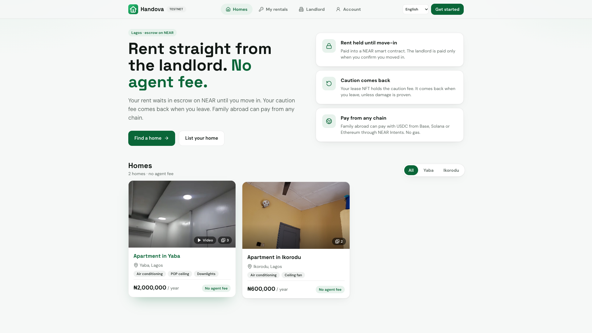
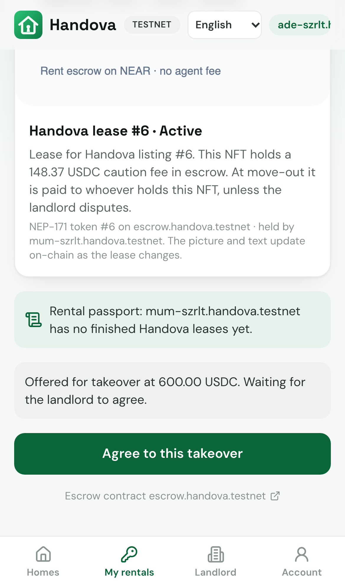
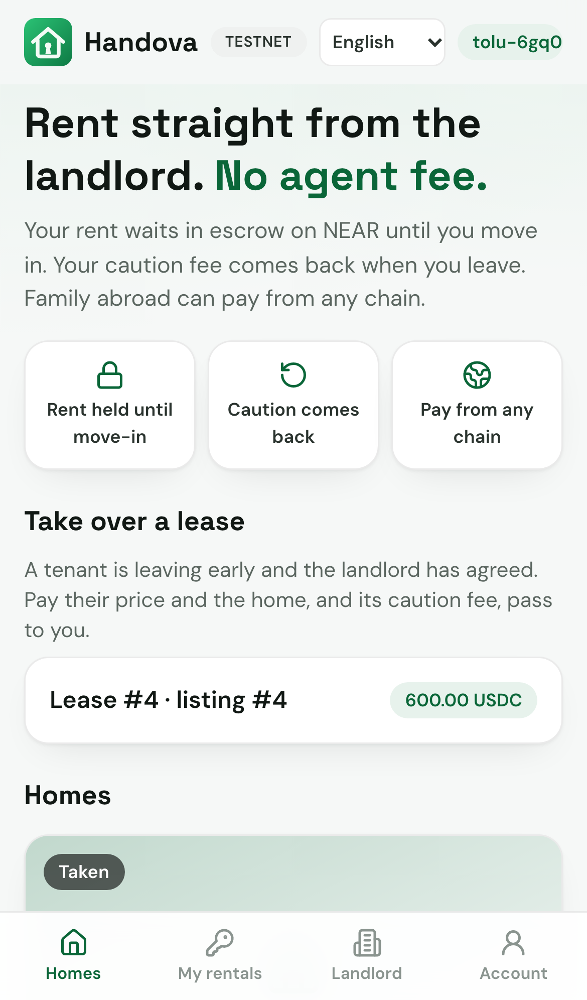
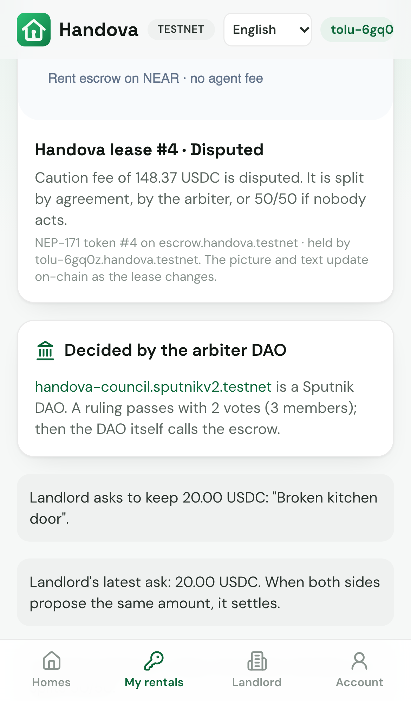
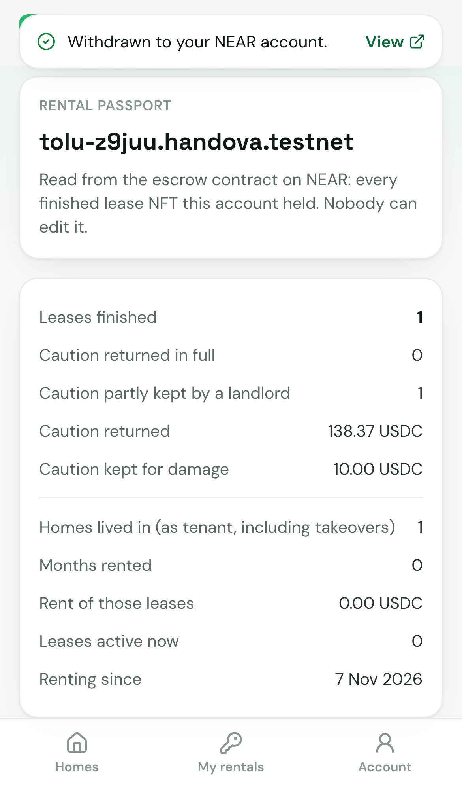
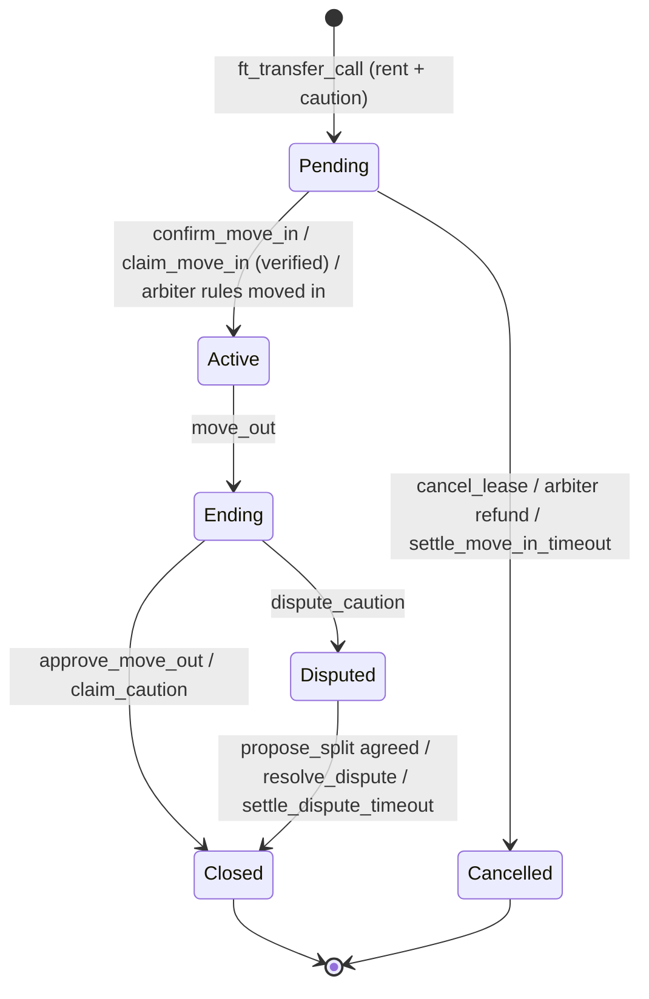

# Handova — rent in Lagos straight from the landlord, with the rent in escrow on NEAR

Handova lets a tenant rent a home directly from the landlord, with no agent. The tenant (or family abroad) pays rent and the caution fee in USDC into a NEAR smart contract. The landlord is paid when the tenant confirms they moved in (or, only for an ID-verified landlord, if the tenant ignores a marked handover for 3 days). The tenant then holds a **lease NFT that carries the right to the caution fee**: at move-out the contract pays the caution to whoever holds that NFT, unless the landlord disputes it. A tenant leaving early can **sell the rest of their lease** to a next tenant the landlord agreed to.

**What is real, what is simulated, what is not proven yet:**

| | |
|---|---|
| ✅ **Real on NEAR testnet** | Escrow + lease NFT contract [`escrow-v3.handova.testnet`](https://testnet.nearblocks.io/address/escrow-v3.handova.testnet) (with a test USDC token; the account has no keys, so its code can't be changed); pay → move-in → NFT → takeover → move-out → caution to the holder ([lease #2](docs/EVIDENCE.md#one-full-lease-on-escrow-v3), team-run demo accounts); takeover and a Mintbase sale only to the buyer the landlord agreed to; gasless app actions (NEP-366); a 2-of-3 Sputnik DAO as arbiter (all three members are team accounts today) |
| ⚠️ **Simulated** | **Pay from any chain** and **landlord cash-out** (NEAR Intents 1Click): quotes are live, but Intents has no testnet, so the deposit arriving is simulated with test USDC. No real cross-chain payment has been made |
| ⏳ **Not proven yet** | Real use: two real Lagos homes are listed (Yaba, Ikorodu), nobody has rented through Handova. No mainnet deployment. No security audit. ID checks prove who a landlord is, not that they own the home |

Who controls what (owner, arbiter, verifier, the deploy key) is in [Trust model and known limits](#trust-model-and-known-limits).

**Built at NEAR HACKATHON (1–14 Nov 2026).** Tracks: `realworld`, `nfts`. Built on an earlier Arc version of Handova; only the NEAR work is the entry — see [Built before / during the hackathon](#built-before--during-the-hackathon).

- 🌍 **Try it live (testnet, phone or desktop):** https://handova-near.vercel.app — web app on Vercel, API (relayer, keeper, accounts, ID checks) on Railway
- 🎬 **Demo video (3 min, real testnet, four phones, Nigerian narrator):** YOUTUBE_LINK
- 🧪 **Reproduce it yourself:** [`REPRODUCE.md`](REPRODUCE.md) — three commands, your own testnet accounts, no keys from us
- 📜 **Contract:** [`contract/src/`](contract/src) · **Server:** [`server/near/`](server/near) · **Web app:** [`web/src/`](web/src) · **Browser tests:** [`e2e/`](e2e)



|  |  |  |  |
|---|---|---|---|
| Homes, priced in Naira | Voice note → listing (NEAR AI, verified TEE) | Pay from Base, Solana… (NEAR Intents; live quote, deposit simulated on testnet) | Lease NFT holding the caution fee |
|  |  |  |  |
| Landlord sees the next tenant's passport and agrees to them | Leases offered for takeover | Disputes go to a 2-of-3 DAO vote | The tenant's rental passport |

**Contents:** [The problem](#the-problem) · [The one moment](#the-one-moment) · [The lease NFT](#the-lease-nft-that-holds-the-caution-fee) · [Escrow rules](#escrow-rules-and-lease-states) · [Trust model](#trust-model-and-known-limits) · [Try it](#try-it) · [Testing](#testing) · [Built before / during the hackathon](#built-before--during-the-hackathon) · [Built vs planned](#built-vs-planned) · [How NEAR is used](#how-near-is-used) · Architecture, landlord verification, review fixes: [`docs/ARCHITECTURE.md`](docs/ARCHITECTURE.md) · Contract methods, API, configuration: [`docs/REFERENCE.md`](docs/REFERENCE.md) · Proof for each claim: [`docs/EVIDENCE.md`](docs/EVIDENCE.md)

---

## The problem

- **A year up front, to strangers.** Rent is usually paid for the whole year before moving in. Fake listings take the money and disappear.
- **Fees on top.** Agent and agreement fees are added to the rent.
- **The caution fee is a gamble.** Getting the security deposit back depends on the landlord's goodwill.
- **Family abroad often pays.** Transfers to Nigeria are slow and expensive, and the payer has no say over when the landlord gets the money.

(We quote no market percentages: we have no cited source yet.)

## The one moment

> *The story we're building towards; the cross-chain step is simulated today.* A nurse in London pays her mum's Lagos rent from a wallet on another chain → it lands in the Handova escrow on NEAR → mum confirms she moved in → only then is the landlord paid → mum holds the lease NFT → at move-out the caution fee returns to her. No agent fee, no gas.

| | What happens | NEAR piece |
|---|---|---|
| 0 | Ade signs up as a landlord; he can verify his ID with Didit and the badge is written on NEAR | NEP-413 signed message · `set_verified` |
| 1 | Ade (landlord) describes his flat in Pidgin; NEAR AI drafts the listing; he adds photos, checks it and publishes | NEAR AI Cloud (TEE) · gasless `create_listing` |
| 2 | The nurse pays rent + caution **for mum** from Base USDC (simulated on testnet: live quote, then test USDC arrives) or with USDC on NEAR | NEAR Intents 1Click → `ft_transfer_call` |
| 3 | The money is locked in the escrow, status `Pending` | `ft_on_transfer` |
| 4 | Ade marks the handover; mum confirms move-in | `mark_handover`, `confirm_move_in` |
| 5 | Rent is credited to Ade; mum receives lease NFT #N holding the caution | NEP-171 mint, live metadata |
| 6 | Ade withdraws the full rent | pull-based `withdraw` |
| 7 | Mum moves out; Ade approves; the caution goes to the NFT holder | `move_out`, `approve_move_out` |

Every step is in the [demo video](YOUTUBE_LINK) (four phones side by side — landlord, nurse abroad, mum, next tenant — recorded from the real app on testnet with [`scripts/record-demo.mjs`](scripts/record-demo.mjs)) and in [`bun run demo:testnet`](scripts/demo-testnet.ts).

## The lease NFT that holds the caution fee

An NFT on NEAR can't hold tokens by itself. So **one contract is both the escrow and the NEP-171 token contract**: the caution stays in the contract's USDC balance, and the right to get it back is bound to `nft_token(lease_id).owner_id` at payout time — not to a stored tenant address.

| Lease status | NFT | Caution |
|---|---|---|
| `Active` | Moves only to the next tenant the landlord agreed to (every route: `nft_transfer`, `nft_transfer_call`, takeover, marketplace). The caution right moves with it | Held |
| `Ending` (move-out review) / `Disputed` | **Locked** | Held |
| `Closed` | Locked; stays with the tenant as a record of a finished lease | Paid out (amounts recorded on the lease) |

The metadata is never stored: `nft_token`, `nft_tokens` and `nft_tokens_for_owner` compute the title (`Handova lease #2 · Active`), description, `extra` JSON (`status`, `caution_held`, `ends_at_ms`…) and an SVG picture from the current lease state.

NEP-171 transfers need exactly 1 yoctoNEAR, which the relayer never pays, so the holder signs a transfer directly (new accounts get 0.05 NEAR for this).

### Selling the rest of a lease (takeover)

A tenant who leaves early can hand the home — and the caution right — to the next tenant:

1. The holder calls `offer_takeover(lease_id, price)`. The price can be 0 (a free handover to family).
2. The next tenant calls `request_takeover(lease_id)`; the landlord sees their rental passport.
3. The landlord calls `consent_takeover(lease_id)`, which agrees to **that** account only. A new offer clears the agreement.
4. The agreed tenant pays the price with one `usdc.ft_transfer_call(escrow, price, '{"take_over": <lease id>}')` — gasless in the app. The seller is credited the price, the NFT moves to the buyer (approvals cleared, NEP-171 `nft_transfer` event), and the buyer becomes the tenant.

Offers show on the home page under **Take over a lease**. The holder can also sell through an external marketplace with standard **NEP-178** approvals and **NEP-199** payouts (tested with Mintbase), but the escrow completes the sale only to the agreed tenant. A plain `nft_transfer`, even to the holder's own second wallet, follows the same rule.

### Rental passport

`rental_record(account_id)` turns the lease NFTs an account held into a record nobody can edit: leases finished, how many times the caution came back in full, caution kept for damage, homes lived in, months rented and the rent of those leases (after a takeover the buyer counts as the tenant, so the lease's rent is attributed to them). Tenants see it under **Account → My rental passport** (`#/passport/<account>`); a landlord sees a summary of the tenant's record on every lease waiting for a handover or a takeover.

## Escrow rules and lease states

| Situation | What happens on-chain |
|---|---|
| Tenant (or anyone for them) pays | Rent + caution locked, status `Pending`. Overpayment refunded; a bad `msg` refunds everything |
| Tenant confirms move-in | Rent credited to the landlord; lease NFT minted to the tenant (`Active`) |
| Landlord marked the handover, tenant silent 3 days | **Only for ID-verified landlords:** anyone can trigger `claim_move_in`. An unverified landlord always needs the tenant's confirmation. ID is not proof of ownership or of a real handover: a verified landlord who marks a false handover still gets paid if the tenant doesn't dispute within 3 days |
| Holder offers the lease, a next tenant asks, the landlord agrees to them, they pay | Seller paid the price; NFT and caution right move to the buyer, who becomes the tenant |
| Either side disputes the handover | `dispute_move_in` (once); the arbiter rules moved-in or full refund |
| Handover disputed, arbiter silent 7 days | Anyone can trigger `settle_move_in_timeout`: the payer is refunded in full |
| No handover within 7 days of payment | Tenant or payer cancels; the **payer** is refunded in full. The landlord can decline any time before move-in |
| Tenant moves out (or landlord, after the term ends) | 7-day landlord review (`Ending`): approve → full caution to the NFT holder; or dispute part of it |
| Landlord silent for the review window | Anyone can trigger `claim_caution`: full caution to the NFT holder |
| Caution dispute | Both propose the same split → settles; or the arbiter decides (never more than the landlord claimed); nobody settles in 7 days → 50/50, capped at the landlord's claim |
| Payouts | Pull-based `withdraw`; if the token transfer fails, the balance is restored |



Who can change what is in the [trust model](#trust-model-and-known-limits). Waiting periods are fixed at deployment (3 days handover claim; 7 days cancel, review and dispute).

## Trust model and known limits

**Who can do what on the escrow** (`escrow-v3.handova.testnet`, checked on testnet 3 Nov 2026):

| Who | Can | Cannot |
|---|---|---|
| Tenant / NFT holder | Confirm move-in, dispute a handover, start move-out, claim the caution after the review window, offer the lease for takeover | Take rent back after move-in; move the NFT to anyone (even their own wallet) without the landlord agreeing to that receiver |
| Next tenant | Ask to take over an offered lease (`request_takeover`), then pay | Take over without the landlord agreeing to them by name |
| Landlord | Mark handover, decline before move-in, approve or dispute the caution (up to the caution amount), agree to one named next tenant, withdraw | Touch the caution without a dispute; claim move-in by silence unless they were ID-verified when the tenant paid and still are |
| Arbiter (Sputnik DAO `handova-council.sputnikv2.testnet`, 2 of 3 votes; members `handova.testnet`, `verifier.handova.testnet`, `tester1604.testnet`, **all controlled by the team**, so this is not independent arbitration yet) | Rule on a disputed handover (moved in, or full refund) and on a caution dispute (never more than the landlord claimed) on leases where it was the arbiter at payment | Act on a lease nobody disputed; pay itself |
| Verifier (`verifier.handova.testnet`) | Give or remove the ID badge for new leases; removing it also blocks a silence claim on an existing lease | Unlock a silence claim on a lease paid while the landlord was unverified; move money |
| Owner (`handova.testnet`) | Replace the arbiter and verifier for **leases paid afterwards**; replace itself | Change who decides an open lease; call any method that moves money |
| Anyone with a key to the escrow account | — | The account has **no access keys** (`view_access_key_list` is empty), so nobody, including the team, can redeploy or change the code |

Each lease records its arbiter and whether the landlord was verified at the moment the tenant paid, so later role changes can't reach into it. The earlier deployments, `escrow.handova.testnet` and `escrow-v2.handova.testnet`, stay on-chain with old test history; v2 still had a deploy key and a replaceable arbiter.

- **Silence claims:** an ID-verified landlord who marks a false handover is paid if the tenant doesn't dispute within 3 days. ID is not proof of ownership or of handing over the keys. A tenant who loses their phone or is offline for 3 days can lose the rent.
- **Lease transfers:** every route (`nft_transfer`, `nft_transfer_call`, the in-app takeover, a Mintbase/NEP-199 sale) moves the NFT only to the account the landlord agreed to. A new offer clears the agreement. If an `nft_transfer_call` receiver hands the NFT back, the holder keeps the lease.
- **Dispute timeout:** if nobody settles a caution dispute in 7 days, it splits 50/50, capped at the landlord's claim. That keeps money from being stuck, but it is not a fair outcome for an honest side.
- **Rental passport:** after a takeover, the buyer is counted as the tenant of the whole lease, so the record can overstate their history.
- **Contract:** pull payments; balance restored on failed `ft_transfer`; every waiting state has a timeout. **Accounting:** `total_held` = all USDC locked on leases + all withdrawable balances. It rises only when USDC enters through `ft_transfer_call` (rent, caution, takeover price) and falls only on `withdraw`, which subtracts first and adds back if the transfer fails. So the contract's USDC balance is never below `total_held`. They are equal except while a withdrawal is in flight, or if someone sends USDC with plain `ft_transfer`, which nothing can claim. The sandbox tests check equality after each settled step.
- **Relayer** ([`relayer.ts`](server/near/relayer.ts)): only function calls to the escrow (fixed method list, zero NEAR attached) or `ft_transfer_call` on USDC (exactly 1 yocto) whose `receiver_id` is the escrow; the ed25519 signature is verified offline and the key must be on the sender's account; arbiter rulings only for the arbiter; total gas ≤ 300 Tgas; per-sender, per-IP and daily limits; balance checks before spending. Also allowed: `nft_approve` only for Mintbase's market (≤ 0.01 NEAR of the user's own balance), `deposit_storage` on that market (≤ 0.02 NEAR), USDC `ft_transfer_call` to the market only when it buys a Handova lease, and cash-out `ft_transfer` only to a NEAR Intents deposit address issued to that same sender within the hour.
- **Gas:** app actions are gasless. Direct NFT transfers are not: NEP-171 needs exactly 1 yoctoNEAR, which the relayer never attaches, so the holder signs and pays (new accounts get 0.05 NEAR for this).
- **Keys:** user keys are generated in the browser and stay there (browser storage: back up the 12-word phrase). Server keys (relayer, account creator, verifier) are only in `.env` (git-ignored). Relayer, keeper, account creator and verifier run on one server.
- **Storage:** the contract pays storage for listings and leases so users never need NEAR, and nothing in the contract charges for it: many accounts can each create 3 free listings by calling it directly (the 1 USDC minimum rent is a price, not a deposit; rate limits only cover Handova's own server). On 4 Nov 2026 the escrow had under 100 KB of free storage, which we estimate about 80 maximum-size listings would fill. If that runs out, calls that store new data, including `confirm_move_in`, fail until someone sends the account more NEAR, which anyone can do without a key.
- **Home-page moderation:** the operator can hide test or spam listings from Handova's own home page (`HIDDEN_LISTINGS`). They stay on-chain and visible to any other NEAR client; hiding can't touch money or leases.

## Try it

### A. Check the live testnet contract (no setup)
```sh
near contract call-function as-read-only escrow-v3.handova.testnet get_config json-args '{}' network-config testnet now
near contract call-function as-read-only escrow-v3.handova.testnet get_lease json-args '{"lease_id":1}' network-config testnet now
near contract call-function as-read-only escrow-v3.handova.testnet nft_token json-args '{"token_id":"1"}' network-config testnet now
near account list-keys escrow-v3.handova.testnet network-config testnet now
```
You'll see the 3-day/7-day rules; lease #1, sold through Mintbase's market after the landlord agreed to the buyer (`payer` is the first tenant, `tenant` and `nft_holder` are the buyer, `arbiter` is fixed on the lease); lease NFT #1 (`"title": "Handova lease #1 · Active"`) owned by the buyer; and an empty key list.

### B. Contract tests (Rust only)
```sh
cd contract && cargo test
```
**42 unit tests** + **3 sandbox tests** (a local NEAR node with a real NEP-141 token: family pays for mum; an NFT transfer refused without the landlord's agreement, then allowed, then a 50/50 timeout; a failed withdrawal keeps the money; the contract's USDC balance equals what it owes after every step).

### C. Your own Handova on testnet (about 3 minutes, no keys from us)
Needs [Bun](https://bun.sh), [near CLI](https://github.com/near/near-cli-rs) and [cargo-near](https://github.com/near/cargo-near).
```sh
bun install
bun run setup:testnet   # faucet accounts, test USDC, escrow, relayer → deploy/testnet.local.json + .env.local
bun run demo:testnet    # the whole story through the real API, gasless, with explorer links
```
Expected output is in [`REPRODUCE.md`](REPRODUCE.md).

### D. The web app
```sh
bun run server          # API on :3001
bun run dev             # http://localhost:5188
```
1. **Get started → Create an account** → pick a name. The recovery phrase is under **Account**.
2. **Landlord → List a home** → type "2 bedroom flat for Yaba, prepaid meter, rent 1.8m per year, caution 200k" → **Draft with NEAR AI** (needs `NEARAI_API_KEY`) → **Publish on NEAR — free**.
3. In another browser profile, create a second account → open the home → **Pay into escrow** → **Get 2,000 test USDC** → **Pay**, or **Any other chain** for a live NEAR Intents quote and a simulated arrival.
4. Landlord: **I've handed over the keys**. Tenant: **I have the keys — confirm move-in**. The lease NFT appears.
5. **Account → Withdraw**. Then move out, approve, and withdraw the caution.

### E. End-to-end suite
```sh
bun run setup:e2e && bunx playwright install chromium && bun run test:e2e
```

## Testing

| Suite | Count | What it proves |
|---|---|---|
| Contract unit (`contract/src/tests.rs`) | 42 | Every escrow rule, NFT locking, caution following the NFT, takeover only to the tenant the landlord agreed to; adversarial cases: no transfer without agreement (direct, own wallet, marketplace), no buyer substitution (by request, payment, transfer or marketplace), a new offer resets agreement, a replaced arbiter can't rule on an open lease, a verifier change or revoked badge can't unlock a silence claim; NEP-178 approvals, NEP-199 marketplace payouts (refused without the landlord's consent), rental passport, verified-only silence claims, arbiter timeout and caps, listing limits, 365-day terms, failed-withdraw restore |
| Sandbox (`contract/tests/sandbox.rs`) | 3 | Real `ft_transfer_call` with a real token on a local node; refunds; an unagreed NFT transfer fails; solvency invariant |
| Server (`server/near/*.test.ts`) | 17 | Relayer allowlist (incl. Mintbase and cash-out rules), offline signature check, gas cap; NEP-413 hashing checked against near-api-js; keeper rules; Intents quote shapes (pay-in and cash-out); AI inspection limits; NEAR AI signer recovery from a real saved receipt |
| End-to-end (`e2e/*.spec.ts`, Playwright) | 29 | A phone-sized browser drives the real app against a testnet deployment with 20-second waiting periods; balances checked on-chain after each step; any console error fails a test |

The end-to-end cases: happy path; recovery phrase and restore; taken name; family pays for someone else; payer cancel and landlord decline refunds; verified landlord claims after silence; unverified landlord can't, and a silent arbiter means a refund; tenant disputes a fake handover and the arbiter rules both ways; unverified landlord escalates and the arbiter rules moved in; every caution outcome (agreement, arbiter, 50/50, tenant claim, keeper); passing the lease NFT on; listing pause/reprice; Intents quotes (Base, Solana) and simulated arrival; NEAR AI draft with a verified receipt; relayer and admin guards; **lease takeover** (offer, next tenant asks, landlord agrees, buyer pays, caution goes to the buyer); **rental passport** (record after a finished lease, shown to the next landlord); **five languages** (switch and persist); **a real 2-of-3 Sputnik DAO** deciding a caution dispute through the app (one vote isn't enough; the second executes the ruling).

**Latest results on v3:**

| Suite | Needs | Result |
|---|---|---|
| Contract unit, sandbox, server | Nothing live (local only) | 42, 3 and 17 passed from a clean clone of `bffbc77`, 4 Nov 2026 |
| Browser, 3–4 Nov 2026 | Testnet, public RPCs, NEAR AI credit | **All 29 have passed, but not in one run:** 24 first time, 3 on rerun, 2 in a separate run with a new NEAR AI key |

- The 3 reruns are the arbiter tests: public-RPC rate limits (HTTP 429) failed them in the full run.
- The 2 NEAR AI tests (listing draft, move-out inspection) failed in the full run because the API key was over its spend limit (`402 api_key_limit_exceeded`), then passed on v3 code with a new key.
- Browser tests run on a test deployment with the same code hash as `escrow-v3`, with 20-second waiting periods instead of days.

Per-claim proof, the code hash and transaction links are in [`docs/EVIDENCE.md`](docs/EVIDENCE.md).

The suite found real bugs that were then fixed: pages not refreshing when a deadline passed, the arbiter blocked by the relayer, NFT transfer running out of gas money, an AI draft cut off by reasoning tokens, and server errors that hid a drained wallet.

## Built before / during the hackathon

Handova first existed on **Arc** (Circle's L1) as a Solidity + USDC app: [`UseHandova/Handova`](https://github.com/UseHandova/Handova), commit `16fe0e4` (21 Oct 2026). It got little traction there, so we rebuilt it on NEAR during NEAR HACKATHON. **Only the NEAR work is the hackathon entry.**

- The first commit (tag **`baseline-arc`**) imports the Arc-era code unchanged, with no NEAR code and no Solidity. Later the EVM/Circle parts were **deleted** (no `@circle-fin`, wagmi, viem or ConnectKit remain); what carried over: brand assets, `server/media.ts` (photo uploads), the translation wording, and the Didit flow (adapted, see below).
- Everything after it is hackathon work: the Rust contract (written from scratch, not ported), `server/near/`, `shared/`, `web/`, `e2e/`, `scripts/`, `deploy/`. Diff: `git diff baseline-arc..hackathon-submission --stat` (on GitHub: `compare/baseline-arc...hackathon-submission`).

### Libraries and AI-written code
- Contract: `near-sdk` 5.30, `near-contract-standards` 5.30, `base64`; tests: `near-workspaces` 0.24, `tokio`.
- Server/web: `near-api-js` 7.4, `@hot-labs/near-connect` 0.12, `borsh`, `@noble/curves` + `@noble/hashes` (NEAR AI receipt signatures), `express`, `multer`, `react` 18, `vite`, `tailwindcss`, `lucide-react`, `qrcode`, `vite-plugin-node-polyfills`; tests: `@playwright/test`.
- External services: NEAR RPC (FastNEAR and others), NEAR Intents 1Click API, NEAR AI Cloud, Didit (identity checks), open.er-api.com (USD→NGN display rate).
- The Didit flow in [`server/near/verify.ts`](server/near/verify.ts) is adapted from the Arc version's `server/verification.ts` (same Didit calls and safeguards). What's new for NEAR: proving account control with a NEP-413 signed message instead of an EVM signature, and recording the result with the escrow's `set_verified` instead of a Solidity call.
- Video: recorded with Playwright, narrated with YarnGPT (Nigerian English voice), composed with `ffmpeg-static`.
- Most of the NEAR-edition code was written with **Claude Code** (Anthropic), directed and reviewed by the team.

### Other project
The team also submitted **PatchBond** (refundable bonds for pull requests), an independent project.

## Built vs planned

| | Status |
|---|---|
| Rust escrow with every rule, lease NFT holding the caution, dynamic metadata, events | ✅ live on testnet, tested |
| Gasless relayer (NEP-366) with allowlist and signature checks | ✅ |
| Named accounts with device keys + recovery phrase; NEAR Connect | ✅ |
| Arbiter desk, listing controls, NFT hand-over, keeper | ✅ |
| Lease takeover market: the landlord agrees to a named next tenant; NEP-178 approvals | ✅ |
| Rental passport | ✅ |
| Arbiter as a Sputnik DAO (2-of-3 council, proposals and votes in the app) | ✅ live: `handova-council.sputnikv2.testnet`; independent members ⏳ |
| Interface in English, Naijá, Yorùbá, Hausa, Igbo | ✅ main screens (native-speaker review pending) |
| NEAR AI voice note → listing, with checked TEE receipt | ✅ |
| Pay from any chain (NEAR Intents 1Click) | ⚠️ built but **not run live**: quotes, deposit address, status polling and auto-pay are coded; on testnet the deposit is **simulated** |
| NEAR AI document pre-check | ⚠️ API only; no admin screen yet |
| Lease sale on Mintbase's market (NEP-199 payouts, only to the agreed tenant) | ✅ proven on `escrow-v3` with `scripts/mintbase-sale-testnet.ts` (refused before the landlord agreed, completed after; lease #1) |
| Landlord cash-out to any chain (NEAR Intents) | ⚠️ live quotes on testnet; sending runs on mainnet only (like the payment side) |
| AI move-out inspection (NEAR AI vision, TEE receipt) | ✅ advisory; landlord, tenant or council decide |
| Landlord ID verification (Didit → NEP-413 → `set_verified` on NEAR) | ✅ built; live checks need Didit credits on the team's account |
| Tenant / landlord roles chosen at sign-up, switchable | ✅ |
| Desktop layout: grid, area tabs, pages, animations | ✅ |
| Real landlords and tenants | ⏳ two real Lagos homes listed (Yaba, Ikorodu); no rentals yet |
| Hosted demo | ✅ https://handova-near.vercel.app (web on Vercel, API on Railway). Needs paid credits to work: NEAR AI (drafts, inspection) and Didit (ID checks); the escrow flow needs neither |
| Full translation of every screen and message | ⏳ planned |

## How NEAR is used

| Feature | NEAR technology | Where |
|---|---|---|
| Escrow that pays the landlord only after move-in; caution returned at move-out | Rust contract, near-sdk 5.30 | [`contract/src/escrow.rs`](contract/src/escrow.rs) |
| Pay rent + caution in **one transaction** | NEP-141 `ft_transfer_call` → `ft_on_transfer`; excess refunded | [`escrow.rs` `ft_on_transfer`](contract/src/escrow.rs) |
| Lease NFT that **holds** the caution fee | NEP-171 + enumeration + metadata in the same contract as the escrow | [`contract/src/nft.rs`](contract/src/nft.rs) |
| NFT that shows the live lease | Dynamic metadata: title, description, `extra` and an on-chain SVG built from the lease at view time | [`nft.rs` `live()`](contract/src/nft.rs), [`svg.rs`](contract/src/svg.rs) |
| No gas for app actions (direct NFT transfers excepted) | NEP-366 meta transactions: the phone signs a delegate action; the relayer verifies it and pays gas | [`server/near/relayer.ts`](server/near/relayer.ts), [`shared/gasless.ts`](shared/gasless.ts) |
| Accounts for people without a wallet | Named sub-accounts `name.handova.testnet` created with the **device's own key**; 12-word recovery phrase | [`server/near/accounts.ts`](server/near/accounts.ts), [`web/src/lib/session.tsx`](web/src/lib/session.tsx) |
| Verified landlords | Didit ID + liveness + face check. The landlord first proves control of the account with a **NEP-413 signed message**; on approval Handova's verifier account calls `set_verified` on the escrow, which unlocks the badge, silence claims and more than 3 listings | [`server/near/verify.ts`](server/near/verify.ts), [`shared/nep413.ts`](shared/nep413.ts), [`VerifyIdentity.tsx`](web/src/components/VerifyIdentity.tsx) |
| Existing NEAR wallets | NEAR Connect (`@hot-labs/near-connect`): HOT, Meteor, MyNearWallet, Intear… | [`session.tsx`](web/src/lib/session.tsx) |
| Pay from any chain (**simulated on testnet**) | NEAR Intents 1Click: `EXACT_OUTPUT` quote → deposit on the origin chain → USDC delivered to the payer's NEAR account → gasless `ft_transfer_call` into escrow | [`server/near/intents.ts`](server/near/intents.ts), [`IntentsPay.tsx`](web/src/components/IntentsPay.tsx) |
| Voice note or text → listing draft | NEAR AI Cloud, models in TEEs (`openai/whisper-large-v3`, `z-ai/glm-5.3-flash`); each answer has a receipt the server checks | [`server/near/ai.ts`](server/near/ai.ts) |
| Ownership document pre-check (admin, never approves) | NEAR AI Cloud vision model in a TEE (`z-ai/glm-5.3-flash`) | `POST /api/ai/document-check` |
| Hand a lease to the next tenant | In-contract takeover market (holder's price, next tenant asks, landlord agrees to them, they pay with one `ft_transfer_call`) plus NEP-178 approvals for external marketplaces | [`contract/src/market.rs`](contract/src/market.rs), [`nft.rs`](contract/src/nft.rs) |
| Sell a lease on NEAR marketplaces | **NEP-199 payouts** (`nft_payout`, `nft_transfer_payout`): a marketplace sale completes only to the next tenant the landlord agreed to; the buyer becomes the tenant. Tested with Mintbase's open market contract on testnet (`market-v2-beta.mintspace2.testnet`), listed and bought from Handova's lease page | [`nft.rs`](contract/src/nft.rs), [`MintbaseListing.tsx`](web/src/components/MintbaseListing.tsx), [`scripts/mintbase-sale-testnet.ts`](scripts/mintbase-sale-testnet.ts) |
| Landlords cash out to any chain (**simulated on testnet**) | NEAR Intents 1Click, the other way round: exact USDC from the landlord's NEAR account → USDT on TRON / BNB Chain, USDC on Base / Solana… at their exchange or wallet. The relayer only sends to a deposit address issued to that landlord | [`intents.ts`](server/near/intents.ts), [`CashOut.tsx`](web/src/components/CashOut.tsx) |
| AI move-out inspection | NEAR AI vision model in a TEE compares the listing's photos with move-out photos and suggests a share of the caution, with a checked receipt. Advice only; requested by the landlord or holder with a NEP-413 signature | [`inspect.ts`](server/near/inspect.ts), [`Inspection.tsx`](web/src/components/Inspection.tsx) |
| Rental passport | `rental_record` view computed from the finished lease NFTs an account held | [`market.rs`](contract/src/market.rs), [`Passport.tsx`](web/src/components/Passport.tsx) |
| Disputes decided by a DAO vote, not one key (arbiter fixed on each lease at payment; today's members are all team accounts) | Sputnik DAO (`sputnikv2.testnet`) as the arbiter: members propose a ruling and vote; the DAO calls the escrow | [`scripts/create-arbiter-dao.ts`](scripts/create-arbiter-dao.ts), [`web/src/lib/dao.ts`](web/src/lib/dao.ts), [`DaoRulings.tsx`](web/src/components/DaoRulings.tsx) |
| Timeouts nobody acted on | Keeper calls the contract's "anyone may trigger" methods | [`server/near/keeper.ts`](server/near/keeper.ts) |
| Following lease events | NEP-297 `EVENT_JSON` logs for every step | [`contract/src/events.rs`](contract/src/events.rs) |

Languages: the main screens are in English, Naijá (Pidgin), Yorùbá, Hausa and Igbo, using the wording the team wrote for the Arc version (new lines still need a native-speaker review). Listing drafts are tested on English and Pidgin text; voice goes through Whisper, which lists English, Yorùbá and Hausa (not Igbo).

### More features

- **Tenants and landlords:** people choose at sign-up whether they're renting or letting (switchable on the Account page); tenants get *My rentals*, landlords get their landlord page with the Didit ID check.
- **Landlord cash-out** to an exchange on any chain (USDT on TRON or BNB Chain, USDC on Base or Solana…) through NEAR Intents: live quotes, simulated on testnet.
- **Mintbase:** a leaving tenant can list the lease on Mintbase's NFT market; the sale completes only if the landlord agreed (NEP-199 payouts).
- **AI move-out inspection:** either side can ask NEAR AI to compare the listing photos with move-out photos and suggest a caution split, with a TEE receipt. Advice only.
- **Layout:** on desktop, homes show in a grid with area tabs and pages, and detail pages split into two columns; on phones everything is one column. A listing's video plays on hover (or while on screen on a phone).

## License
MIT — see [LICENSE](LICENSE).
