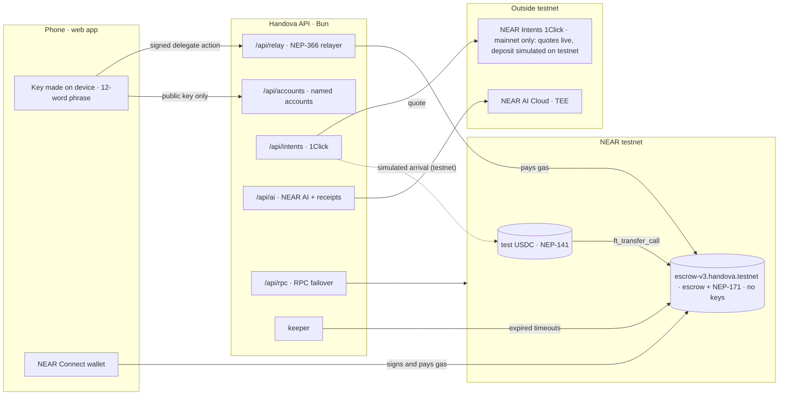
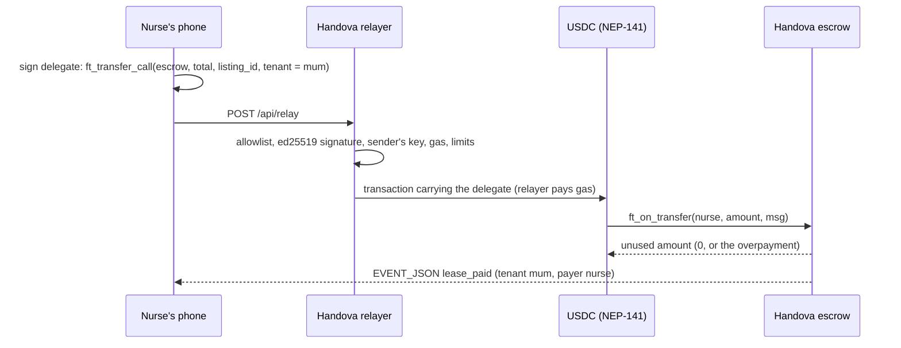

# Handova architecture

How the parts fit together, how landlords are verified, and what code review changed. The overview is in the [README](../README.md).

## Architecture

Paying rent gaslessly, in one transaction:

| Folder | What |
|---|---|
| `contract/` | Rust escrow + lease NFT (`src/`), unit tests (`src/tests.rs`), sandbox tests (`tests/sandbox.rs`), test-only USDC (`mock-ft/`) |
| `server/near/` | NEAR API: relayer, accounts, Intents, NEAR AI, keeper, RPC proxy, FX rate |
| `server/index.ts` | API entry point (`bun run server`); `server/media.ts` handles photo uploads |
| `shared/` | Used by both browser and server: gasless client, transaction-outcome parsing, units |
| `web/` | The NEAR web app |
| `e2e/` | Playwright end-to-end suite against testnet |
| `deploy/<network>.json` | Contract IDs per network — nothing is hardcoded |
| `scripts/` | `setup-testnet.sh`, `deploy-testnet.sh`, `demo-testnet.ts`, `record-demo.mjs` + `compose-demo.mjs` (video), `ai-review.ts` |

## Landlord verification (Didit → NEAR)

To limit fake listings, the contract treats **ID-verified landlords** differently: only they can collect rent when a tenant ignores a marked handover for 3 days, and only they can list more than 3 homes. Tenants see the badge on every listing.

How a landlord gets verified (Landlord page → *Verify my identity*):

1. **Prove the account.** The app asks the server for a one-time message and the landlord signs it with their NEAR key as a **NEP-413** signed message (no transaction, no gas). Handova accounts sign with the key on the phone; NEAR wallets sign through NEAR Connect. The server checks the ed25519 signature and that the key is a **full-access key of that account**, so nobody can verify someone else's account. Challenges are single use and expire after 10 minutes.
2. **Check the person.** The landlord takes a photo of their ID and a selfie on **Didit**'s page (document check, liveness, face match).
3. **Record it on NEAR.** When Didit approves, Handova's verifier account calls `set_verified(account, true)` on the escrow (`landlord_verified` event). The badge is public, on-chain, and readable by any app (`is_verified`).

Safeguards: one ID document can verify one account (kept only as a keyed hash of country + ID number, never the number itself); 5 attempts per account per day; Didit can only send people back to Handova's own address; a check finished on another phone or in a closed tab is collected next time the landlord opens the page; Handova never stores ID photos or names, Didit does. The verifier can only set the badge, but the badge matters: it lets a landlord claim move-in by the tenant's silence.

## Code review fixes

We had the contract and server reviewed by models on NEAR AI Cloud ([`scripts/ai-review.ts`](../scripts/ai-review.ts)) and fixed what checked out against the code. This is not a security audit. What changed for users:
- An unverified landlord can't collect rent by the tenant's silence; the tenant must confirm. Silence claims for ID-verified landlords remain (see Escrow rules).
- Money can't be locked by an arbiter who never rules: if a disputed handover isn't decided within the dispute window, anyone can trigger a full refund to the payer (`settle_move_in_timeout`).
- A dispute can't be dragged out by re-opening it, and the arbiter can't award the landlord more than they claimed.
- The relayer no longer pays gas for requests with a forged signature.
